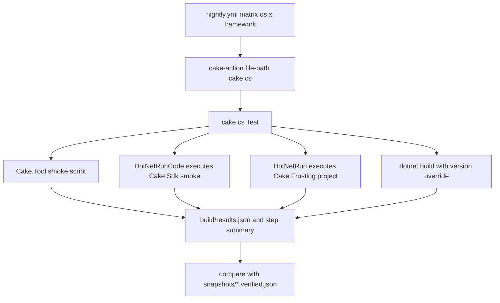

# Cake contrib pre-release integration tests

Nightly checks that cake-contrib addins and modules still load and compile against Cake 7 pre-release packages from the [Cake Azure Artifacts feed](https://pkgs.dev.azure.com/cake-build/Cake/_packaging/cake/nuget/v3/index.json).

Each GitHub Actions job runs `cake.cs` (Cake.Sdk) on one OS and one target framework (`net10.0` or `net11.0`). For every catalog package it:

- Loads the latest stable NuGet.org release of the addin/module into the latest pre-release Cake.Tool, Cake.Sdk, and Cake.Frosting from the Cake feed
- Rebuilds the addin's GitHub source against the latest pre-release Cake packages from the Cake feed (see [Cake versions](#cake-versions))



## Local run

```powershell
dotnet run cake.cs -- --target=Test --framework=net10.0 --framework=net11.0 --package=Cake.FileHelpers --package=Cake.Git --package=Cake.Frosting.Git
```

## Cake versions

Every check uses the latest Cake 7 pre-release packages (Cake.Tool, Cake.Sdk, Cake.Frosting, Cake.Core, Cake.Common) from the Cake feed.

- [`prepare.cs`](prepare.cs) resolves them, patches the `#:sdk Cake.Sdk@…` pin in `cake.cs` so the orchestrator runs on the latest Cake.Sdk too, and on GitHub Actions publishes them as step outputs and `INTEGRATION_CAKE_{NAME}_VERSION` environment variables.
- CI resolves once per run in the `prepare` job; each matrix leg re-runs `prepare.cs` with those versions as arguments so all legs test the same build.
- `cake.cs` uses `INTEGRATION_CAKE_*_VERSION` when set, otherwise it resolves the latest itself.
- Rebuilds patch every package `nuget.config` maps to the Cake feed (`Cake.Core`, `Cake.Common`, `Cake.Cli`, `Cake.NuGet`, `Cake.DotNetTool.Module`, `Cake.Frosting`, `Cake.Tool`, `Cake.Sdk`, `Cake.Generator`) via [`src/CakePrerelease.targets`](src/CakePrerelease.targets), with or without central package management, and add direct `Cake.Core`/`Cake.Common` references when they would otherwise only come in transitively.

Bump the local `cake.cs` pin to the latest Cake.Sdk:

```powershell
dotnet run prepare.cs
```

## Snapshots

The run does not fail just because a check failed. Many addins are not yet compatible with Cake 7 pre-release, so results are approval-tested instead (similar to [Verify](https://github.com/VerifyTests/Verify)):

- After `Test`, each run's results are projected to `{ id, check, framework, status, reason }` rows (versions, exit codes and error messages are left out) and compared with `snapshots/{os}-{arch}-{tfm}.verified.json`.
- Any difference, including a fix (`failed` to `passed`), fails the run and writes `build/snapshots/{os}-{arch}-{tfm}.received.json`. A missing verified file counts as empty.
- Runs filtered with `--package` or `--shard` only compare the selected packages; rows for other packages are kept as-is in the received file.

Accept local results, review, and commit:

```powershell
dotnet run cake.cs -- --target=Accept
git diff snapshots/
```

Accept results from a CI run (requires the [GitHub CLI](https://cli.github.com/), logged in). On GitHub Actions, the `Teardown` uploads received snapshots as `snapshots-{os}-{arch}-{tfm}-{shard}` artifacts (and `results.json` as `results-…`):

```powershell
dotnet run cake.cs -- --target=Accept --run=<runId>
```

## Catalog

[`catalog/addins.json`](catalog/addins.json) lists cake-contrib addins and modules.

### Format

Each entry is a JSON object:

| Field          | Required | Description                                                                            |
| -------------- | -------- | -------------------------------------------------------------------------------------- |
| `id`           | yes      | NuGet package id                                                                       |
| `kind`         | no       | `addin` (default) or `module`                                                          |
| `repository`   | no       | GitHub `owner/name` used for rebuild clones                                            |
| `runners`      | no       | Hosts to load: `tool`, `sdk`, `frosting`. Omitted or empty means all three             |
| `usings`       | no       | Extra `using` namespaces for the generated Frosting host (and assembly-name fallbacks) |
| `smoke`        | no       | C# statements used as the smoke body when no `smoke/{id}/{id}.cs` file exists          |
| `exclusions`   | no       | Rules that skip load and/or rebuild when every set field matches                       |

Exclusion rule fields (all optional; unset fields match anything):

| Field            | Values                                                                           |
| ---------------- | -------------------------------------------------------------------------------- |
| `runner`         | `tool`, `sdk`, `frosting`. Omit on a rule to skip rebuild as well as all loads   |
| `os`             | `windows`, `linux`, `osx`                                                        |
| `framework`      | e.g. `net10.0`, `net11.0`                                                        |
| `architecture`   | e.g. `x64`, `arm64`                                                              |
| `reason`         | Shown on the skipped result                                                      |

```json
{
  "id": "Cake.Frosting.Git",
  "kind": "addin",
  "repository": "cake-contrib/Cake_Git",
  "runners": [ "sdk", "frosting" ],
  "usings": [ "Cake.Git" ]
}
```

Each published package is inventoried from its NuGet nupkg: declared `Cake.Core` dependency versions and `lib` target frameworks. Those values are stored on every result row (`CakeCore`, `Tfms`) and shown in the summaries.

## Custom smoke files

If `smoke/{PackageId}/{PackageId}.cs` exists (for example [`smoke/Cake.FileHelpers/Cake.FileHelpers.cs`](smoke/Cake.FileHelpers/Cake.FileHelpers.cs)), that file replaces the default load-only smoke body for Cake.Tool, Cake.Sdk, and Cake.Frosting.

The file is C# statements inserted where `ICakeContext context` is in scope. Call addin aliases on `context`.

Precedence: on-disk file, then catalog `smoke`, then a default load log. These files are not compiled into the orchestrator (`IncludeAdditionalFiles` is only `src/**/*.cs`).
